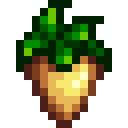
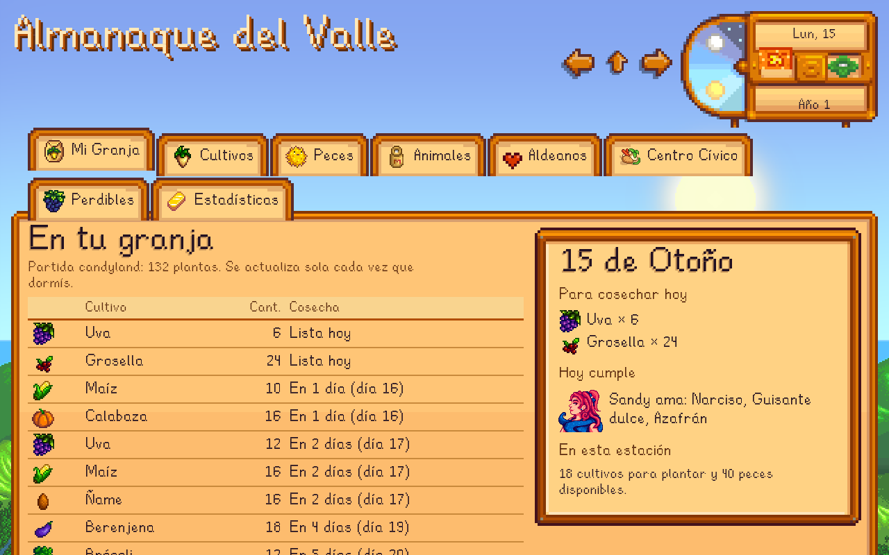
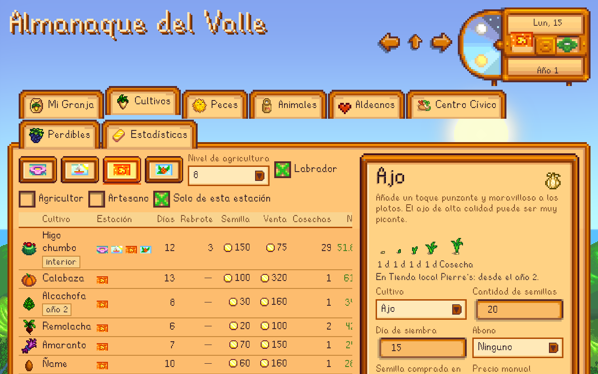
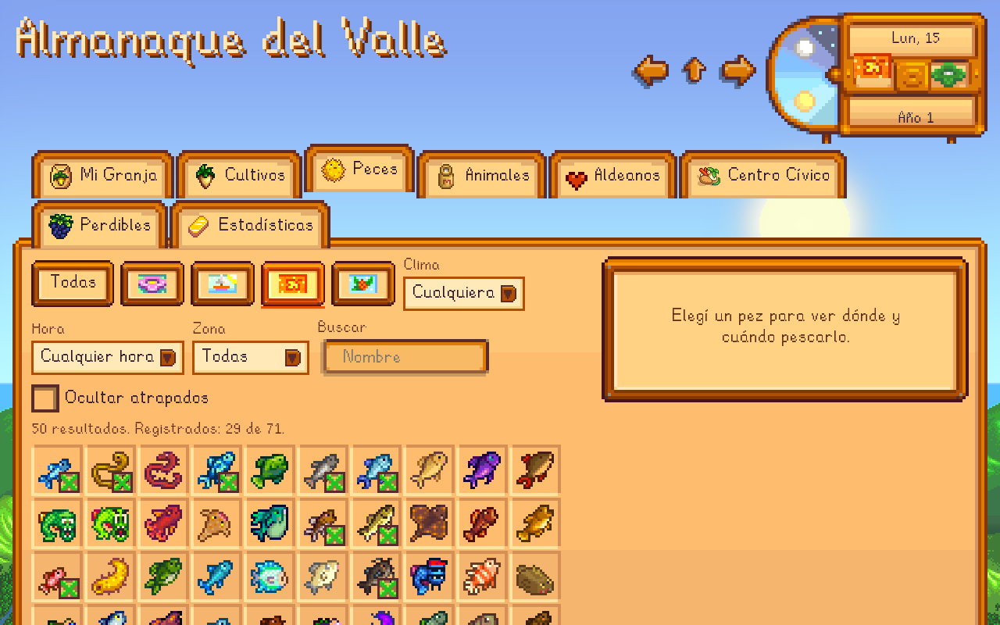
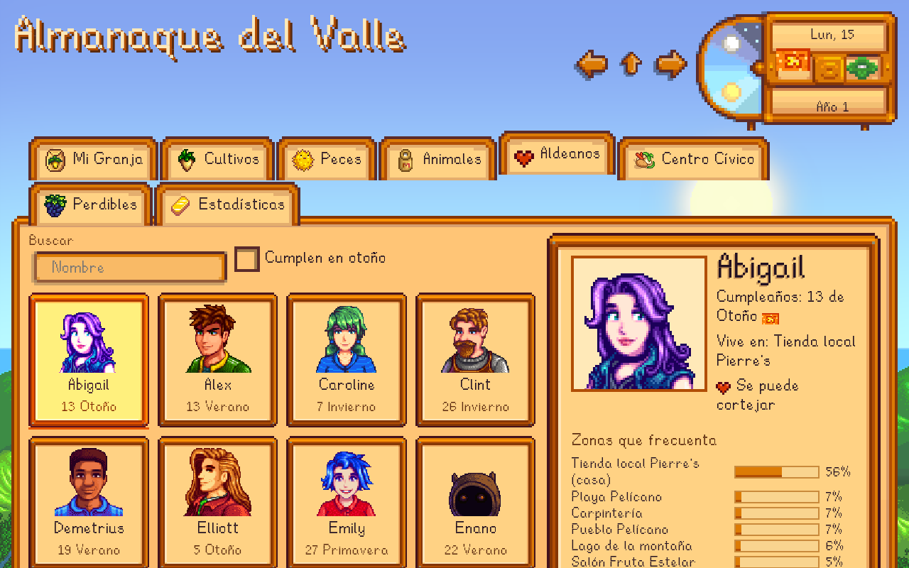
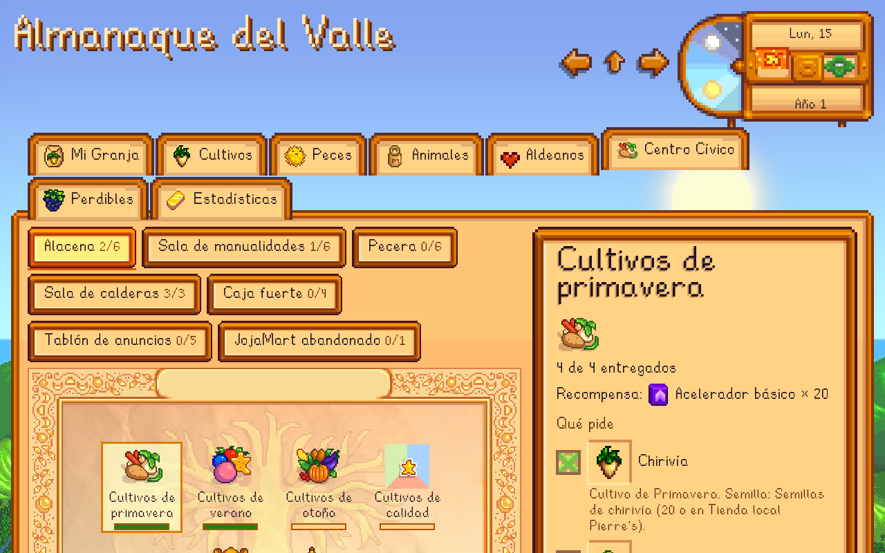
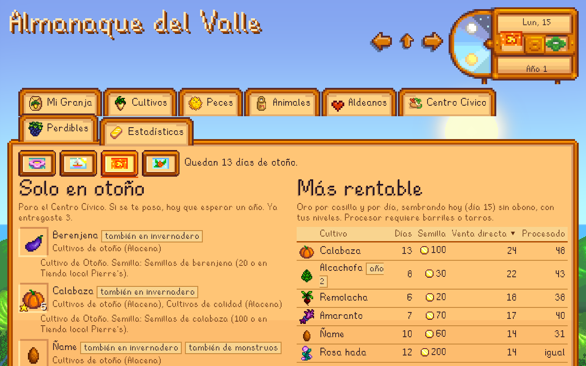
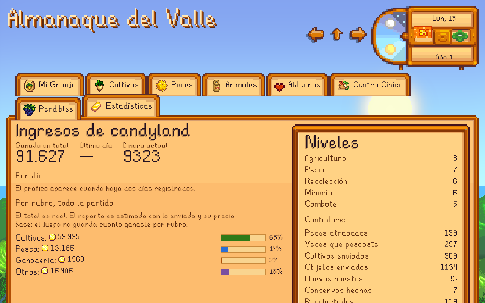

<div align="center">



# Almanaque del Valle

**La guía de Stardew Valley que conoce tu granja.** En español, sin internet y conectada a tu partida.

[Página de presentación](https://gonviv05.github.io/almanaque-del-valle/) · [Instalar](#instalación) · [Descargar ZIP](https://github.com/GonViv05/almanaque-del-valle/archive/refs/heads/main.zip)



</div>

## Qué hace

Es una wiki local con la estética del juego, armada con los datos de **tu propia instalación** de Stardew Valley. Se abre en el navegador y funciona sin conexión.

| Pestaña | Para qué sirve |
| --- | --- |
| **Mi Granja** | Qué está plantado, cuándo se cosecha y quién cumple años hoy, leído de tu partida |
| **Cultivos** | Tabla por estación y calculadora de semillas, abono, cosechas y ganancia |
| **Peces** | Filtros por estación, clima, hora y zona; marca los que ya atrapaste |
| **Animales** | Ciclo de vida, productos, precios y cómo conseguir cada uno |
| **Aldeanos** | Cumpleaños, regalos favoritos y por dónde andan |
| **Centro Cívico** | Salas, lotes y de dónde sale cada objeto |
| **Perdibles** | Lo que se te escapa si no lo hacés esta estación y lo más rentable para sembrar hoy |
| **Estadísticas** | Ingresos, niveles y contadores de tu partida |

## Capturas

| | |
| --- | --- |
|  |  |
|  |  |
|  |  |

## Instalación

Necesitás Stardew Valley instalado (Steam o GOG), Python 3.9+ y Node.js 22.7+. El repositorio no trae archivos del juego: el instalador los genera desde tu copia.

**Windows:** [descargá el ZIP](https://github.com/GonViv05/almanaque-del-valle/archive/refs/heads/main.zip), descomprimilo y hacé doble clic en `instalar.bat`. Si falta Python o Node, los instala con winget.

**Linux:**

```sh
git clone https://github.com/GonViv05/almanaque-del-valle.git
cd almanaque-del-valle
sh instalar.sh
```

El instalador encuentra el juego, genera la wiki, crea un acceso directo y ofrece activar el vigía. Si no detecta el juego, te pide la carpeta.

| Opción | Efecto |
| --- | --- |
| `--juego "<ruta>"` | Usa esa carpeta del juego |
| `--con-vigia` / `--sin-vigia` | Activa o descarta el vigía sin preguntar |
| `--sin-acceso` | No crea el acceso directo |
| `--desinstalar` | Quita el vigía y el acceso directo |

Después de actualizar el juego, volvé a correr el instalador. Está probado con la versión 1.6.15.

## El vigía de la partida

`tools/vigia.py` corre en segundo plano y detecta cuando el juego guarda al dormir. Actualiza la wiki, registra tus ingresos diarios y avisa los cumpleaños con una notificación. **Tus guardados solo se leen**, y no es un mod: no hace falta SMAPI.

El ingreso diario total es real. El reparto por cultivo, pesca y ganadería es estimado, porque el juego solo guarda el total.

## Desarrollo

```sh
node tools/test-calc.mjs
python3 tools/test-vigia.py "<carpeta de una partida>"
```

`tools/notas-manuales.json` guarda los pocos datos que el juego tiene en su código y no en sus archivos. En la app aparecen marcados como nota manual.

---

Proyecto de fans, sin relación con ConcernedApe. Stardew Valley, sus sprites, textos y fuentes son propiedad de ConcernedApe.
