<div align="center">

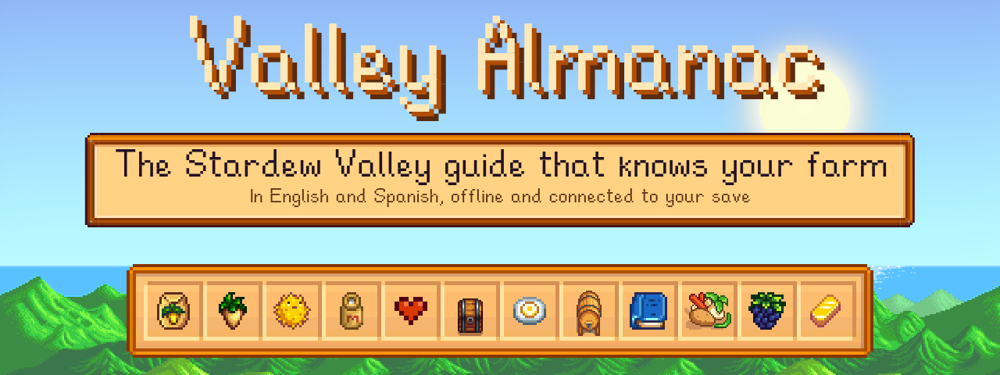

**English** · [Español](README.es.md)

<a href="https://gonviv05.github.io/valley-almanac/">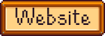</a> <a href="#installation">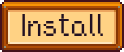</a> <a href="https://github.com/GonViv05/valley-almanac/archive/refs/heads/main.zip">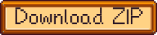</a>


</div>

<h2>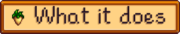</h2>

A local wiki with the game's look, built from the data in **your own install** of Stardew Valley. It opens in the browser and works offline. It comes in English and Spanish: the ES/EN buttons under the title switch between them.

<table>
<tr><th width="190" align="left">Tab</th><th align="left">What it's for</th></tr>
<tr><td width="190">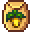&nbsp;<b>My&nbsp;Farm</b></td><td>What's planted, when it's ready and whose birthday it is today, read from your save</td></tr>
<tr><td width="190">&nbsp;<b>Crops</b></td><td>Table by season and a calculator for seeds, fertilizer, harvests and profit</td></tr>
<tr><td width="190">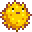&nbsp;<b>Fish</b></td><td>Filters by season, weather, time and location; marks the ones you've caught</td></tr>
<tr><td width="190">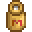&nbsp;<b>Animals</b></td><td>Life cycle, produce, prices and how to get each one</td></tr>
<tr><td width="190">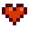&nbsp;<b>Villagers</b></td><td>Birthdays, favorite gifts and where they hang out</td></tr>
<tr><td width="190">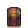&nbsp;<b>Crafting</b></td><td>The crafting recipes you know, how many you can make with what you have and how to learn the locked ones</td></tr>
<tr><td width="190">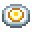&nbsp;<b>Cooking</b></td><td>What you can cook right now, which recipes have every ingredient in season and how to get each one</td></tr>
<tr><td width="190">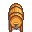&nbsp;<b>Artisan&nbsp;Goods</b></td><td>What each machine processes, what the result is worth and the best use for what you have stored</td></tr>
<tr><td width="190">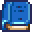&nbsp;<b>Items</b></td><td>Every item in the game (objects, big craftables, weapons, boots, hats, clothing, tools, trinkets and furniture) by type and category, each with its card: where it comes from, what it's for and who likes it</td></tr>
<tr><td width="190">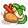&nbsp;<b>Community&nbsp;Center</b></td><td>Rooms, bundles and where each item comes from</td></tr>
<tr><td width="190">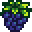&nbsp;<b>Missables</b></td><td>What you'll miss if you don't do it this season, and the most profitable crops to plant today</td></tr>
<tr><td width="190">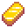&nbsp;<b>Stats</b></td><td>Income, levels and counters from your save</td></tr>
</table>

At the top there's a **search box** (`/` or `Ctrl+K`) for items, villagers, recipes and festivals. Search for a villager and it tells you where they should be, at the time you pick, on the day set in the almanac. Click any item (an ingredient, a gift, a bundle slot) to open its card with how to get it. The **calendar** (next to the clock) is the town billboard with birthdays and festivals: one click takes you to that day.

<h2>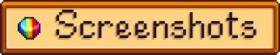</h2>

<table>
<tr><td width="50%"></td><td width="50%"></td></tr>
<tr><td width="50%">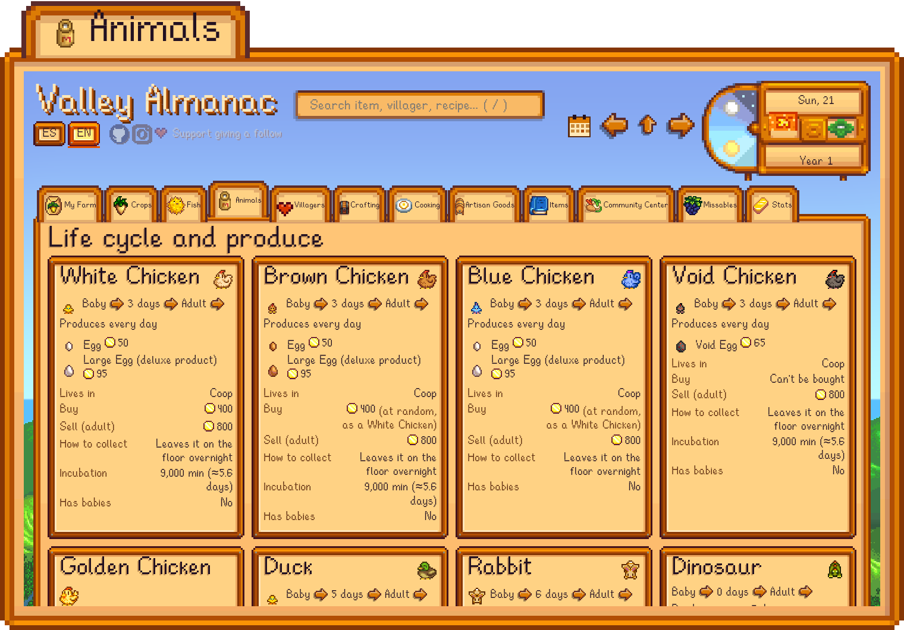</td><td width="50%"></td></tr>
<tr><td width="50%">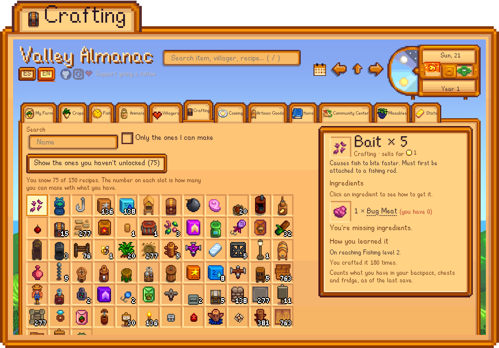</td><td width="50%">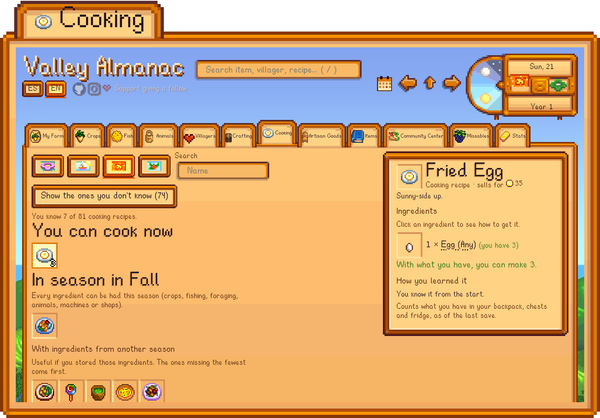</td></tr>
<tr><td width="50%">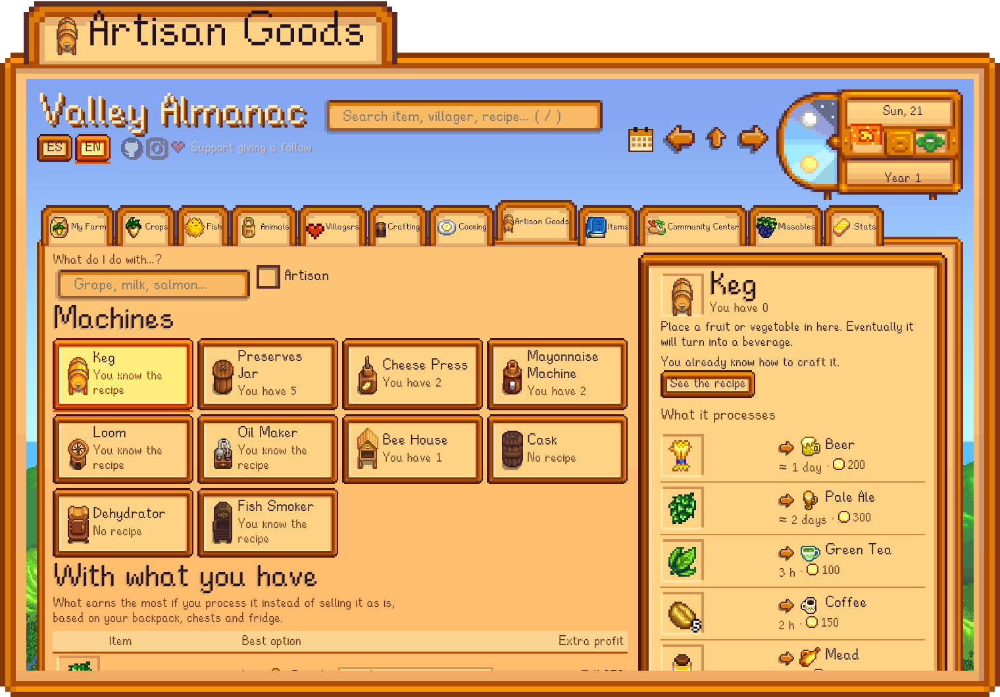</td><td width="50%">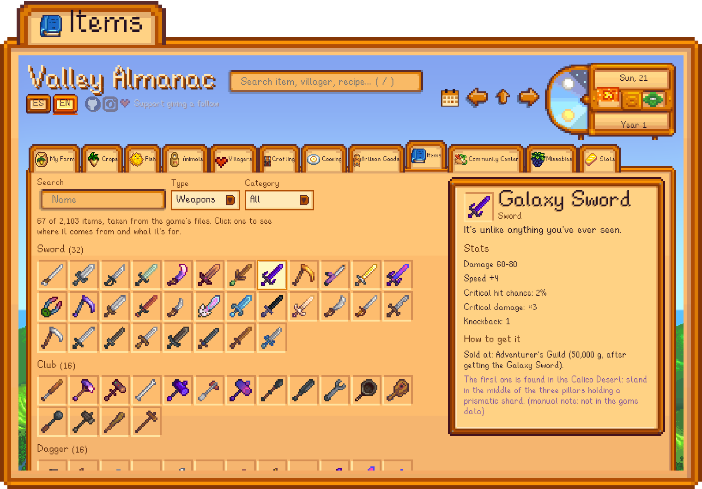</td></tr>
<tr><td width="50%"></td><td width="50%"></td></tr>
<tr><td width="50%"></td><td width="50%">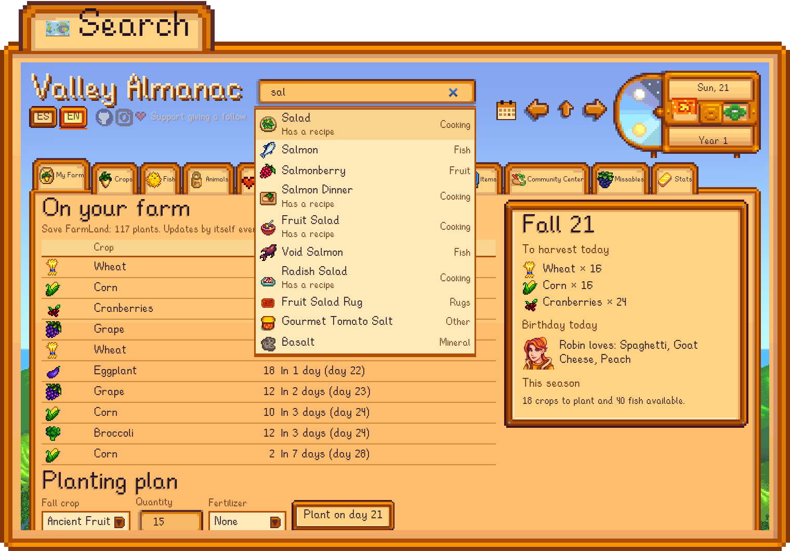</td></tr>
<tr><td width="50%">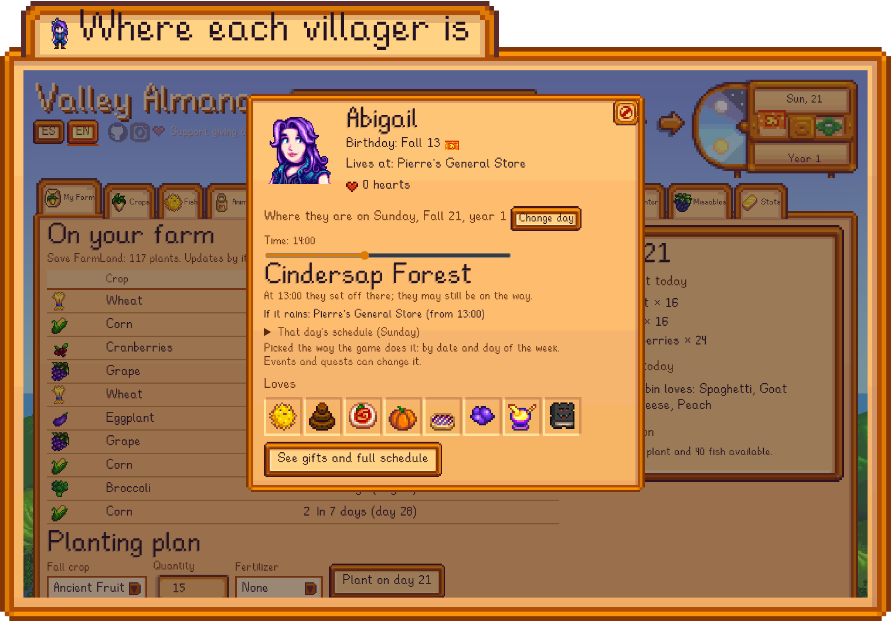</td><td width="50%">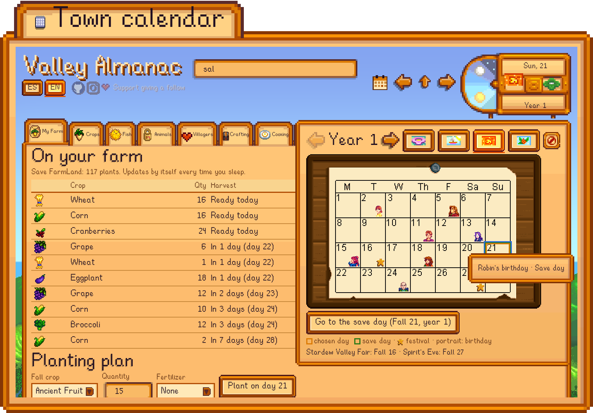</td></tr>
</table>

<a name="installation"></a>
<h2>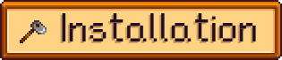</h2>

You need Stardew Valley installed (Steam or GOG), Python 3.9+ and Node.js 22.7+. The repository has no game files: the installer builds them from your copy.

**Windows:** [download the ZIP](https://github.com/GonViv05/valley-almanac/archive/refs/heads/main.zip), unzip it and double-click `instalar.bat`. If Python or Node is missing, it installs them with winget.

**macOS:** [download the ZIP](https://github.com/GonViv05/valley-almanac/archive/refs/heads/main.zip), unzip it, move the folder out of Downloads (for example to your home folder: macOS protects Downloads, Documents and Desktop from background programs like the watcher) and double-click `instalar.command`. If macOS won't open it because it's not from an identified developer, go to *System Settings > Privacy & Security* and choose *Open Anyway*, or run it from Terminal:

```sh
cd ~/valley-almanac-main
sh instalar.command
```

If Python is missing, Apple's command line tools installer opens; if Node.js is missing, it installs it with Homebrew or sends you to nodejs.org. It works with the Steam or GOG version of the game.

**Linux:**

```sh
git clone https://github.com/GonViv05/valley-almanac.git
cd valley-almanac
sh instalar.sh
```

The installer finds the game, builds the wiki in both languages, creates a shortcut (on Mac, an app in your Applications folder) and offers to turn on the watcher. If it can't find the game, it asks for the folder. It speaks your system's language.

| Option | Effect |
| --- | --- |
| `--juego "<path>"` | Uses that game folder |
| `--idioma es` / `--idioma en` | Language of the installer, the shortcut and the notifications |
| `--con-vigia` / `--sin-vigia` | Turns the watcher on or skips it without asking |
| `--sin-acceso` | Doesn't create the shortcut |
| `--desinstalar` | Removes the watcher and the shortcut |

After a game update, run the installer again. Tested with version 1.6.15.

<h2>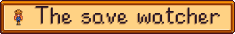</h2>

`tools/vigia.py` runs in the background and notices when the game saves as you sleep. It updates the wiki (crops, learned recipes and what you have in your backpack, chests and fridge), logs your daily income and sends a notification for birthdays. It starts on login (systemd on Linux, launchd on Mac and the Startup folder on Windows). **Your saves are only read**, and it's not a mod: no SMAPI needed.

The total daily income is real. The split between crops, fishing and animals is an estimate, because the game only stores the total.

<h2>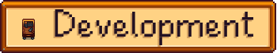</h2>

```sh
node tools/test-calc.mjs
node tools/test-i18n.mjs
python3 tools/test-vigia.py "<save folder>"
```

Game texts come from the game's own files in each language. The almanac's own texts go through `T()`, and `js/i18n-en.js` holds their English version; `tools/test-i18n.mjs` checks that none are missing. `tools/notas-manuales.json` (and `notas-manuales.en.json`) keep the few facts the game has in its code rather than its files. The app marks them as manual notes.

---

Fan project, not affiliated with ConcernedApe. Stardew Valley and its sprites, text and fonts belong to ConcernedApe.
